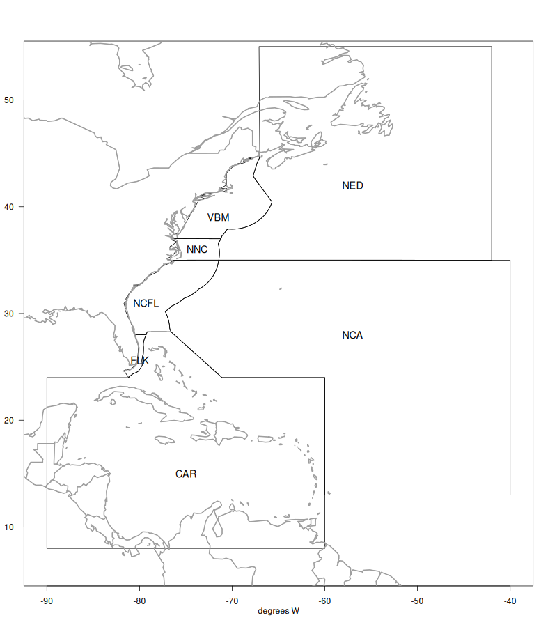

# Data compilation for all fleets in the operating model

In this last step we will compile all of the output data files from the different data sources (NMFS commercial trip tickets, NMFS recreational statistics, Sea Around Us) and check the files for accuracy.

Recall that there are seven defined areas in the operating model, over which the catch is summed. Four of these areas are within the U.S. EEZ and the other three areas are international waters (high seas and jurisdictional waters of other countries).

** Later due to computational issues in resolving the very fine spatial scales, we collapsed the seven areas into five areas, combining CAR + FLK into one area and NNC + VBM into another area. 

__*** Note that the magnitudes of the recreational catch estimates changed substantially in an October 2026 update, due to revised FES estimates. The most recent data were pulled and are shown here.__



## Data upload

First we access all of the final data files from the previous steps.

```{r}
#| echo: true

# clear workspace
rm(list = ls())

# view data files in directory
dir("data/FINAL_files/")

scenario <- "low"

if (scenario == "high") { intc <- read.csv("data/FINAL_files/CAR_Intl_hi_TomFormat.csv") } # high intl scenario
if (scenario == "low")  { intc <- read.csv("data/FINAL_files/CAR_Intl_lo_TomFormat.csv") } # low intl scenario

intn <- read.csv("data/FINAL_files/NCA_Intl_TomFormat.csv")
intw <- read.csv("data/FINAL_files/NED_Intl_TomFormat.csv")
com <- read.csv("data/FINAL_files/commercial_TomFormat.csv")
rec <- read.csv("data/FINAL_files/rec_catch_TomFormat.csv")
```
The "CAR_Intl_hi_TomFormat.csv" file contains all international landings and unreported catches for the greater Caribbean region (jurisdictional waters of all countries). This includes unreported data and discards, which were very small (\< 1%). Recall that we consider two scenarios: a high and a low international removals scenario. For the visualization here we use the high catch scenario. 

```{r}
#| echo: true
apply(intc[1:4], 2, table, useNA = "always")
intc$Area <- "FLKCAR"

temp <- temp1 <- temp2 <- temp3 <- intc[which(intc$Year == max(intc$Year)), ]
temp$Year <- max(intc$Year) + 1
temp1$Year <- max(intc$Year) + 2
temp2$Year <- max(intc$Year) + 3
temp3$Year <- max(intc$Year) + 4
intc <- rbind(intc, temp, temp1, temp2, temp3)   # impute last four years of data

apply(intc[1:4], 2, table, useNA = "always")
```

The "NCA_Intl_TomFormat.csv" file contains all international landings for the NCA region (i.e., FAO region 31), also known as the Western Central Atlantic. There are no territorial waters in this area (except for Bermuda, which as discussed previously is summarized with the CAR region) and there are no unreported catches or discards in the database.

```{r}
#| echo: true
apply(intn[1:4], 2, table, useNA = "always")

temp <- temp1 <- temp2 <- temp3 <- intn[which(intn$Year == max(intn$Year)), ]
temp$Year <- max(intn$Year) + 1
temp1$Year <- max(intn$Year) + 2
temp2$Year <- max(intn$Year) + 3
temp3$Year <- max(intn$Year) + 4
intn <- rbind(intn, temp, temp1, temp2, temp3)   # impute last four years of data

apply(intn[1:4], 2, table, useNA = "always")
```

The "NED_Intl_TomFormat.csv" file contains all international landings for the NED region (i.e., FAO region 21), also known as the Northwest Atlantic. This includes NED high seas landings, as well as landings from Canadian and French territorial waters which fall in this region. There are no unreported catches or discards for this region in the database.

```{r}
#| echo: true
apply(intw[1:4], 2, table, useNA = "always")

temp <- temp1 <- temp2 <- temp3 <- intw[which(intw$Year == max(intw$Year)), ]
temp$Year <- max(intw$Year) + 1
temp1$Year <- max(intw$Year) + 2
temp2$Year <- max(intw$Year) + 3
temp3$Year <- max(intw$Year) + 4
intw <- rbind(intw, temp, temp1, temp2, temp3)   # impute last four years of data

apply(intw[1:4], 2, table, useNA = "always")
```

The "commercial_TomFormat.csv" file contains all catch for the U.S. commercial fleet, including catch from U.S. EEZs and high seas. There are no unreported catches in this region. Recall that estimated dead discards were very small (\< 2%) and were removed from the summary.

```{r}
#| echo: true
apply(com[1:4], 2, table, useNA = "always")

temp <- temp1 <- com[which(com$Year == max(com$Year)), ]
temp$Year <- max(com$Year) + 1
temp1$Year <- max(com$Year) + 2
com <- rbind(com, temp, temp1) 

apply(com[1:4], 2, table, useNA = "always")
```

The "rec_catch_TomFormat.csv" file contains all landings for the U.S. recreational fleet, which are all assumed to occur within the U.S. EEZs. There are no unreported catches in this region. This file also includes dead discards, which were calculated from the database by year and region and added into the total catch.  

```{r}
#| echo: true
apply(rec[1:4], 2, table, useNA = "always")

rec$Fleet[which(rec$Fleet == "Rec" & rec$Area == "NNCVBM")] <- "RecN"
rec$Fleet[which(rec$Fleet == "Rec" & rec$Area != "NNCVBM")] <- "RecS"
rec$Fleet[which(rec$Fleet == "Hire" & rec$Area == "NNCVBM")] <- "HireN"
rec$Fleet[which(rec$Fleet == "Hire" & rec$Area != "NNCVBM")] <- "HireS"
table(rec$Fleet, rec$Area)

temp <- temp1 <- rec[which(rec$Year == max(rec$Year)), ]
temp$Year <- max(rec$Year) + 1
temp1$Year <- max(rec$Year) + 2
rec <- rbind(rec, temp, temp1) 

apply(rec[1:4], 2, table, useNA = "always")

```

Now we combine the data files and create some figures with the final composite data file.

```{r}
#| echo: true
d <- rbind(intc, intn, intw, com, rec)

# how many rows contain zeros 
#hist(d$Catch_lbs)
table(d$Catch_lbs == 0)

# resort levels geographically
d$Area <- factor(d$Area, levels = c("NCA", "FLKCAR", "NCFL", "NNCVBM", "NED"))
d$Fleet <- factor(d$Fleet, levels = c("RecS", "RecN", "HireS", "HireN", "UScom", "Intl"))

d <- d[order(d$Fleet, d$Area, d$Year, d$Quarter), ]

table(diff(d$Year))
table(diff(d$Quarter))
table(diff(as.numeric(d$Fleet)))
table(diff(as.numeric(d$Area)))
```

## Visualizing the final data set

We plot the final data set in a number of different ways to detect any errors that may have occurred during processing.

```{r}
#| echo: true
#| fig-width: 9

# plot the total catch by each factor
par(mfrow = c(2, 2), mex = 0.7)
barplot(tapply(d$Catch_lbs, d$Year, sum, na.rm = T)/10^6, las = 2,
        main = "Total catch by year", ylab = "total catch (millions of pounds)")
barplot(tapply(d$Catch_lbs, d$Quarter, sum, na.rm = T)/10^6, 
        ylab = "total catch (millions of pounds)", main = "Total catch by quarter")
barplot(tapply(d$Catch_lbs, d$Fleet, sum, na.rm = T)/10^6, 
        main = "Total catch by fleet", ylab = "total catch (millions of pounds)")
barplot(tapply(d$Catch_lbs, d$Area, sum, na.rm = T)/10^6, 
        main = "Total catch by area", ylab = "total catch (millions of pounds)")

tapply(d$Catch_lbs, d$Fleet=="Intl", sum, na.rm = T)/ sum(d$Catch_lbs, na.rm = T) * 100
dl <- d[which(d$Year == max(d$Year)), ]
tapply(dl$Catch_lbs, dl$Fleet=="Intl", sum, na.rm = T)/ sum(dl$Catch_lbs, na.rm = T) * 100

```

The total catch in the regions analyzed is highly variable but relatively stable over time with a slight decrease in recent years. Most of the catch occurs in quarter 2 (March - May). The largest sector in the U.S. is the private recreational sector, followed by the for-hire fleet and then the U.S. commercial fleet. International catch is 41% of the total removals in the "low" scenario and 55% of the total removals in the "high" scenario. Most of the fishing activity takes place in the Florida Keys and the Greater Caribbean, with other regions contributing much less.

```{r}
#| echo: true
#| fig-height: 4
cols <- c("blue", "deepskyblue", "darkgreen", "chartreuse3", "yellow", "red")

par(mfrow = c(1, 1), mar = c(2, 5, 3, 1))
tab <- tapply(d$Catch_lbs, list(d$Fleet, d$Area), sum, na.rm = T)/10^6
barplot(tab, beside = T, col = cols, legend = rownames(tab),
        main = "Total dolphin catch by area and fleet", 
        ylab = "total catch (millions of pounds)")
```

As expected, U.S. recreational fishing (private and for-hire) only takes place in the four U.S. EEZ regions (FLK, NCFL, NNC and VBM). The U.S. commercial fishery operates largely in those four U.S. EEZ regions, with small amounts of catch in the high seas of NCA, CAR and NED regions. International catches occur largely in the Caribbean, with lesser amounts in the NCA and NED high seas regions.

```{r}
#| echo: true
tab <- tapply(d$Catch_lbs, list(d$Quarter, d$Area), sum, na.rm = T)/10^6
tabp <- apply(tab, 2, function(x) x / sum(x, na.rm = T))

par(mar = c(2, 4, 3, 1))
barplot(tabp, beside = T, col = c("#8CD3DF", "#78B781", "#FFC107", "#A33851"), 
        legend = c("winter (DJF)", "spring (MAM)", "summer (JJA)", "fall (SON)"), 
        args.legend = list(x = 15, y = 0.7, bty = "n"), 
        main = "Total dolphin catch by area and season", 
        ylab = "proportion of catch")
```

This plot shows the seasonal movements of dolphin across the different regions, as expressed through the proportion of catch that occurs in each quarter within each area. In the NCA and CAR regions, most of the catch occurs in winter, whereas in the U.S. South Atlantic regions, most of the catch occurs in spring and summer. In the U.S. Mid-Atlantic the catch also occurs largely in spring, and also fall. In the NED region most of the catch occurs in summer.

```{r}
#| echo: true

tab <- tapply(d$Catch_lbs, list(d$Year, d$Fleet), sum, na.rm = T)/10^6
  
par(mar = c(2, 4, 3, 1))
matplot(rownames(tab), tab, 
        col = cols, 
        type = "l", lwd = 2, lty = c(rep(1, 5), 2, 2), 
        main = "Total annual dolphin catch by fleet", xlab = "",
        ylab = "total catch (millions of pounds)")
legend("topleft", lwd = 2, lty = c(rep(1, 5), 2, 2), bty = "n", 
       c("U.S. private rec - S", "U.S. private rec - N", 
         "U.S. for-hire - S", "U.S. for-hire - N",
         "U.S. commercial",  "International"),
       col = cols)
```
This plot shows the time series of total annual dolphin catch by fleet. We can compare these figures with the plots from the previous chapters to ensure the data were processed correctly. The magnitude and variability of the catch match the expectations.

```{r}
#| echo: true

# output the final concatenated data file
if (scenario == "high") { 
  write.csv(d, file = "data/FINAL_files/complete_catch_dataset_111626_high_fixed.csv", row.names = FALSE)  } # high intl scenario
if (scenario == "low")  { 
  write.csv(d, file = "data/FINAL_files/complete_catch_dataset_111626_low_fixed.csv", row.names = FALSE) } # low intl scenario

d1 <- d[which(d$Year == 2024), ]
round(tapply(d1$Catch_lbs, d1$Fleet, sum, na.rm = T)/10^6/2.205, 3)

```
